<p align="center">
  
</p>

<p align="center">
  
  
  
  
  
  
</p>

<p align="center">
  <a href="#quick-start"><b>Quick start</b></a> ·
  <a href="#muse-models"><b>Muse models</b></a> ·
  <a href="#how-it-works"><b>How it works</b></a> ·
  <a href="#demo-projects"><b>Demos</b></a> ·
  <a href="#honest-by-design"><b>Honest by design</b></a> ·
  <a href="#headless-api"><b>Headless API</b></a>
</p>

<br>

RocketIDE is a chip-design workbench where you and an AI agent work on the same project at the same time. You describe
what you want; the agent edits the design, runs real EDA tools and explains the result. You see every change, approve
what matters, and can do all of it by hand. Whether a check passes is decided by the engine's measurements, never by
what the agent says.

> **Built for the Meta AI Developer Hackathon.** Nothing here existed before the event: every repo in this project was
> created and written between Oct 26 and Nov 4, 2026. We build on open-source tools, used as they are: opencode (the
> agent runtime), ngspice, Icarus Verilog, Magic, KLayout, LibreLane and the sky130A PDK.

<p align="center">
  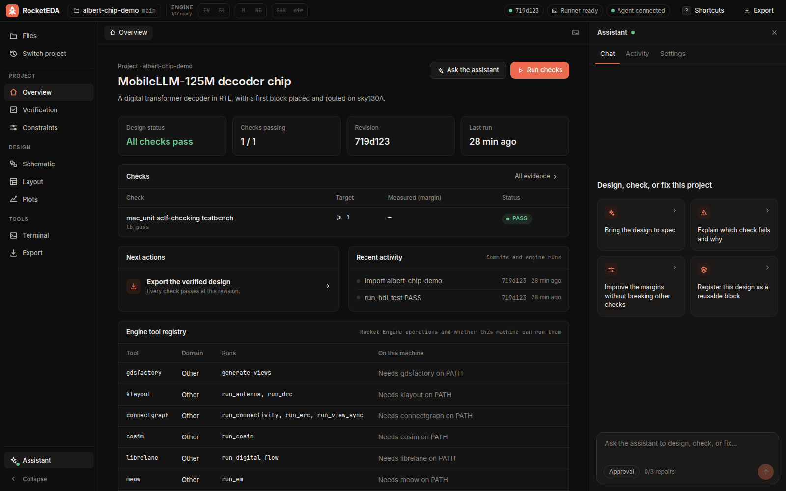
</p>

## Who it's for

Students who want to learn chip design by building one. Learning it usually means costly professional tools, a hard
setup and slow feedback. RocketIDE runs on free, open-source tools and a free PDK. A student can start from a sketch on
paper, get a working design, and learn from a tutor that teaches from their own circuit. Every result comes from a real
simulator, so what they learn is true.

New to it? The start screen offers three guided lessons: your first filter, your first amplifier, and a real op-amp. Each
starts out failing, the student makes the fix, and the simulator decides when they've passed.

## Why RocketIDE

<table>
  <tr>
    <td width="33%" valign="top">
      <h3>One engine, two operators</h3>
      The person in the IDE and the agent drive the same Rocket Engine. A run started by either one shows up for
      both: same evidence, same plots, same verdict.
    </td>
    <td width="33%" valign="top">
      <h3>Verdicts from real tools</h3>
      ngspice, Icarus Verilog, Magic, KLayout and LibreLane do the measuring. Targets come from
      <code>constraints.yaml</code>; the agent can't set or grade its own.
    </td>
    <td width="33%" valign="top">
      <h3>Guardrails built in</h3>
      Protected folders, a repair limit, an allowlist of engine tools and approvals for risky changes, enforced
      by the harness rather than by the prompt.
    </td>
  </tr>
</table>

## Muse models

Each Meta model does the job it's best at, and none of them decides whether a design passes. That's always the engine.

| Model | What it does here | Where to find it |
|---|---|---|
| **Muse Spark 1.3** | Runs the design agent: reads the project, edits the design, calls the engine's tools, reads the measurements and repairs what failed | The assistant panel |
| **Muse Spark, seeing** | Turns a photo of a hand-drawn circuit into a netlist and a testbench the engine then simulates. Reads a lab sheet or datasheet PDF and proposes its targets. Looks at the layout, plot or schematic you have open | **Attach** and **This view** |
| **Muse Spark, teaching** | Learn mode: explains from the student's own circuit and measurements, and asks questions back. It can run checks but can't edit, so the student makes the changes | **Learn** |
| **Muse Wonder 1.0** | An independent auditor of the work: do the checks test what they claim, how thin are the margins, what isn't covered? It can't edit, start runs or change a verdict | **Second opinion** |
| **SAM 3.1** | Marks what you name on a chip layout, such as "power rails" | **Find in layout** |

Muse tools helped build RocketIDE too. Part of the engine was written with Muse Code, and the MobileLLM demo chip was
designed with Muse Spark 1.3 through the engine's MCP tools.

These are the only models RocketIDE calls. Rocket Fuel's config enables no provider except Meta's, and refuses to start
with any other model.

**Every call is visible.** `./run.sh` sends every model call through a small relay that prints each one in the terminal,
with the model name taken from the API's own response:

```text
[Meta Model API] 10:41:03  -> POST /v1/chat/completions  model=muse-spark-1.3  stream
[Meta Model API] 10:41:05  <- 200  model=muse-spark-1.3  tokens in 4210 / out 312  2.14 s  id=req_...
```

The same facts go to `logs/meta-calls.jsonl`, and the app shows them too: the last call above the message box, and all of
them under **Activity**. Keys and prompts are never printed or saved.

## A look inside

<table>
  <tr>
    <td width="50%">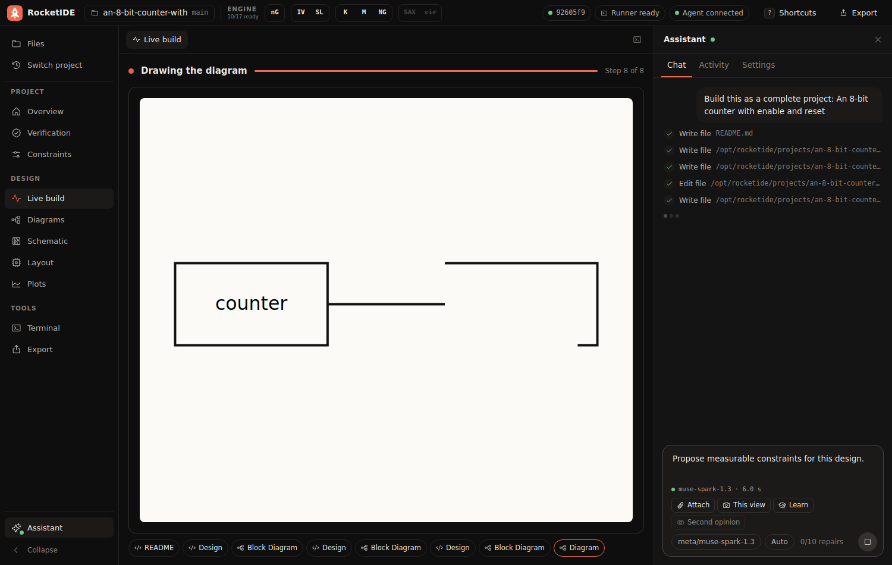</td>
    <td width="50%">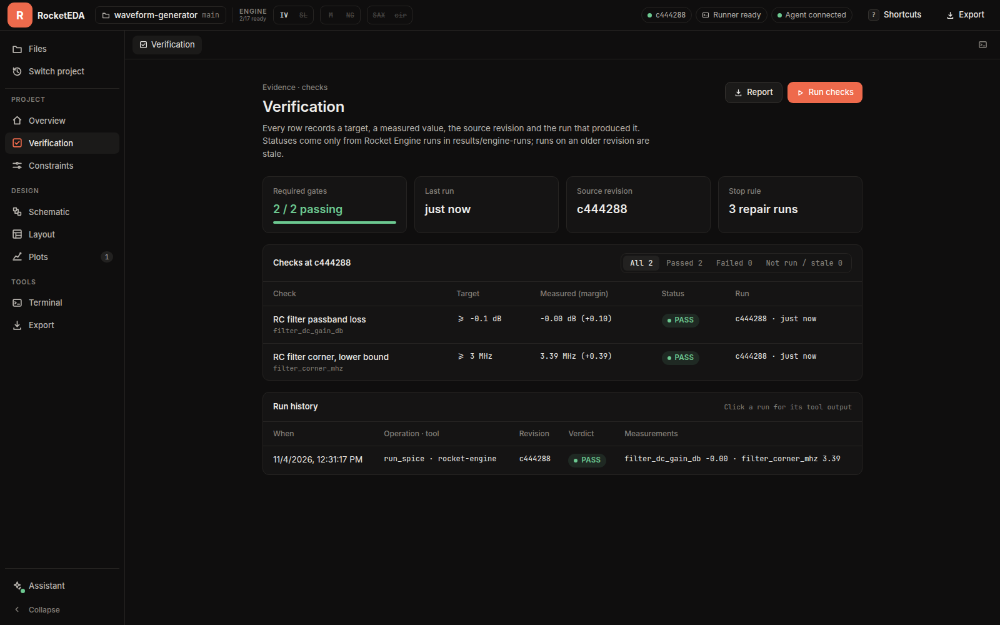</td>
  </tr>
  <tr>
    <td valign="top"><b>Live build.</b> Watch the design take shape as the agent works: code line by line with green and red, drawings mark by mark, and checks landing on their targets. Replay the build afterwards.</td>
    <td valign="top"><b>Verification.</b> How each verdict was reached, every measurement against its target, trends across runs, and which blocks a run has really tested.</td>
  </tr>
  <tr>
    <td width="50%">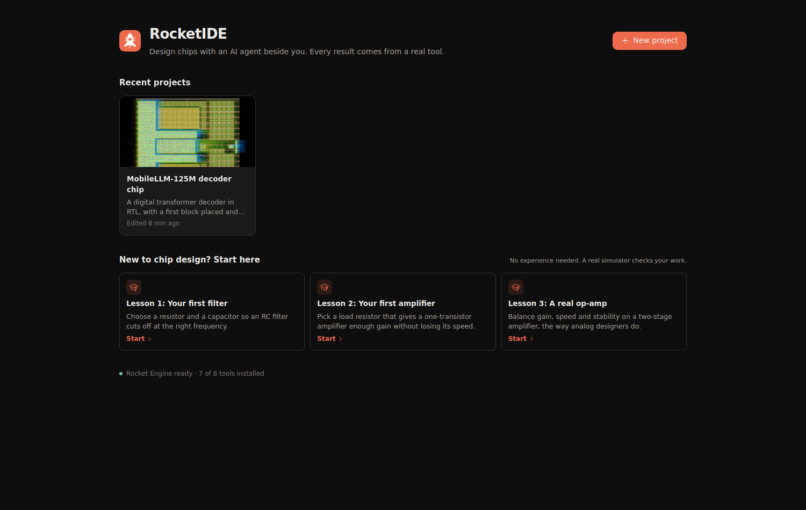</td>
    <td width="50%">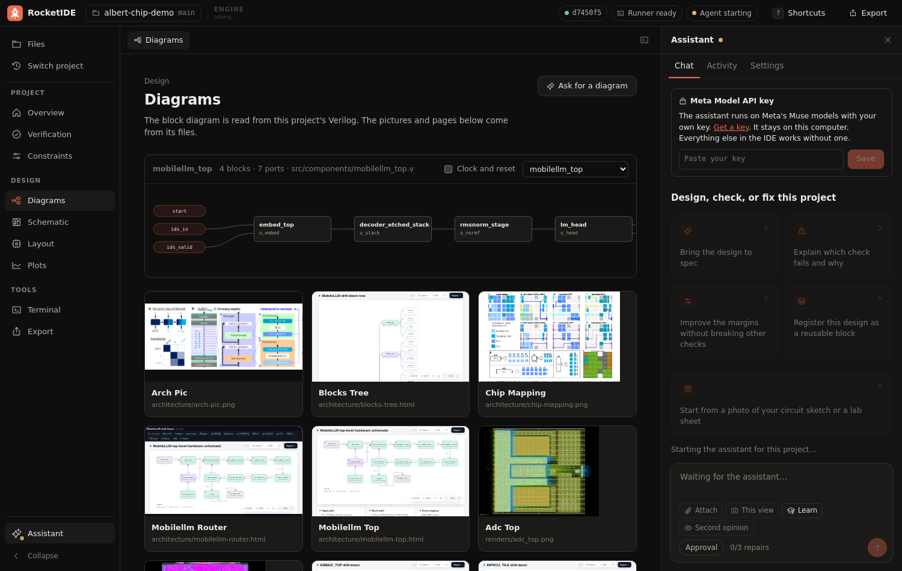</td>
  </tr>
  <tr>
    <td valign="top"><b>Home.</b> Your recent projects with their pictures and last results, a new project from a sentence, and lessons for beginners.</td>
    <td valign="top"><b>Diagrams.</b> A block diagram read from the project's Verilog that you can click through from the top of the chip down, with the pictures and interactive pages it holds. Select blocks to ask the assistant about them.</td>
  </tr>
  <tr>
    <td width="50%">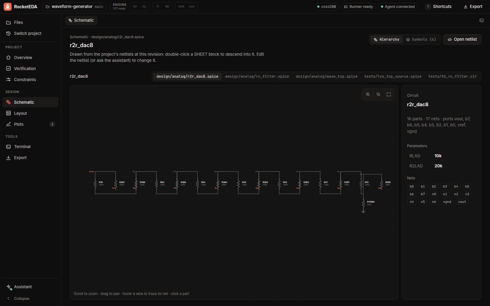</td>
    <td width="50%">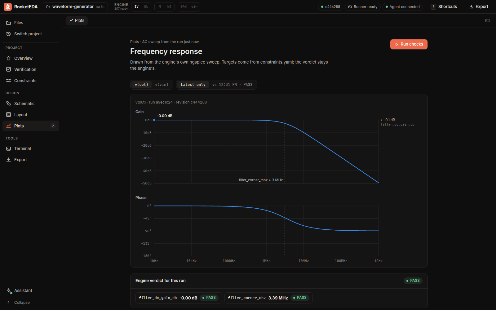</td>
  </tr>
  <tr>
    <td valign="top"><b>Schematic.</b> Drawn from the netlist at this revision.</td>
    <td valign="top"><b>Plots.</b> Bode plots straight from the engine's own sweep, with the targets from <code>constraints.yaml</code> drawn in and the engine's verdict below.</td>
  </tr>
  <tr>
    <td width="50%">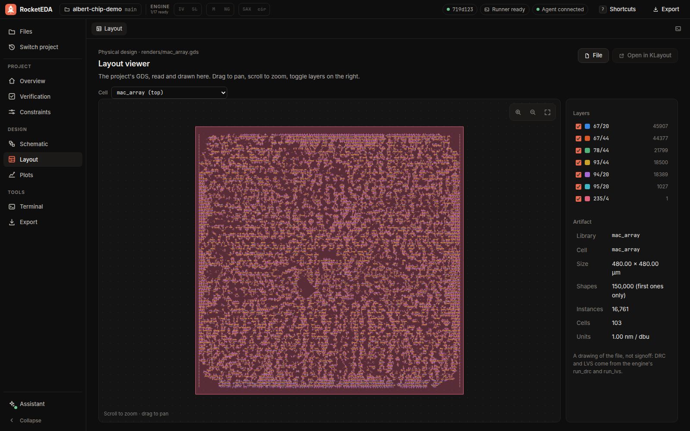</td>
    <td width="50%">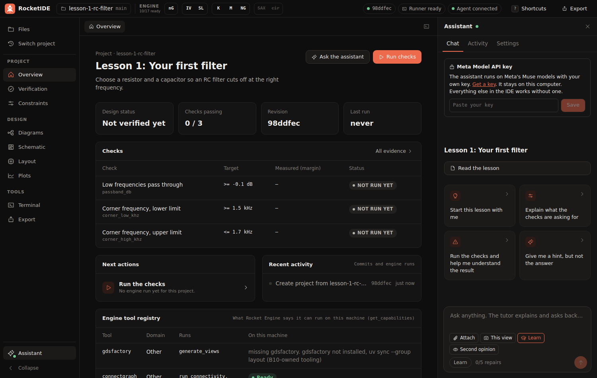</td>
  </tr>
  <tr>
    <td valign="top"><b>Layout.</b> The project's GDS, read and drawn in the browser. Find in layout marks what you name on it.</td>
    <td valign="top"><b>Lessons.</b> Each starts out failing, the student makes the fix, and the simulator decides when they've passed.</td>
  </tr>
</table>

## Demo project

**MobileLLM-125M decoder chip** (`Demos/albert-chip-demo`) is a transformer decoder in RTL on sky130A, with a first block
placed and routed. It opens as its own project, and Run checks runs the Icarus `mac_unit` self-checking testbench through
the engine.

You can also start one of the three lessons, or a new project from the op-amp template, a two-stage amplifier on generic models that needs no
foundry PDK.

## Quick start

**The quickest way is Docker.** You need nothing else, and no account:

```sh
docker run --rm -p 127.0.0.1:5173:5173 ghcr.io/team-rocketeda/rocketide
```

Then open http://localhost:5173. The first start downloads the open-source sky130A PDK (about 140 MB), and the log prints
every model call. To keep your projects and that download between runs, add
`-v rocketide-store:/stores/rocketeda -v rocketide-projects:/opt/rocketide/projects`. The image is built for x86-64, and
runs more slowly under emulation on Apple Silicon.

**To install it on your machine,** you need `git`, Node 20.12 or newer, [`uv`](https://docs.astral.sh/uv/), `zstd`, and the build tools the engine's
provisioner uses to install the EDA tools. On Ubuntu 24.04:

```sh
sudo apt-get install -y curl git zstd ngspice python3 python3-venv make cmake gcc g++ gfortran bison flex swig \
  tcl tcl-dev tk tk-dev libx11-dev bzip2 xz-utils unzip
```

No account is needed to install or run any of it. `install.sh` downloads the open-source sky130A PDK (about 140 MB) if
you don't have one.

```sh
git clone --recurse-submodules https://github.com/Team-RocketEDA/RocketIDE.git
cd RocketIDE
./install.sh            # add --no-desktop to skip Electron
```

Then start the app:

```sh
./run.sh                # http://localhost:5173. The terminal prints every model call
./run.sh desktop        # the same, plus the desktop window
./run.sh --fresh        # start clean: asks first, then deletes all projects and assistant chats
```

**With a Meta Model API key,** open a project and paste your key into the assistant panel. The app checks it with Meta's
API and restarts the assistant with it. You can replace or remove it under **Settings**. It's kept in a private file on
your computer (`~/.config/rocketide/credentials`), outside every project, and never comes back to the browser. You can
also set `MODEL_API_KEY` in `.env`, but a key saved in the app takes priority.

**Without a key,** you can still see everything:

- **The IDE and the engine** work as usual with `./run.sh`: open a demo, press Run checks, read the plots and the
  layout. Only the assistant needs a key.
- **The agent** is in [`docs/sample-runs/`](docs/sample-runs/): real sessions on Muse Spark and Muse Wonder, each with
  its full event stream, the log of every model call, and what the engine produced. `./run.sh replay` plays one back in the
  assistant panel, marked REPLAY, without calling any model.

<details>
<summary><b>Build the Docker image yourself</b></summary>

<br>

```sh
git clone --recurse-submodules https://github.com/Team-RocketEDA/RocketIDE.git
cd RocketIDE
docker build -t rocketide .
docker run --rm -p 127.0.0.1:5173:5173 rocketide
```

It's set up the way the engine's own image is: its locked environment and its pinned toolchain. To use your own PDK, add
`-v /path/to/sky130A:/pdk:ro`.
</details>

## How it works

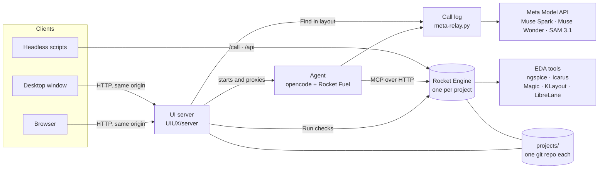

Setup follows the engine team's own flow, with the engine unchanged:

1. **Provision.** `install.sh` runs `rocket-engine/scripts/install.sh --install`. That sets up the engine's Python
   environment, registers the PDK, and installs its pinned toolchain through `provision_toolchain.sh --install`.
2. **Point at the tools.** `run.sh` puts the provisioned tools on `PATH` with `provision_toolchain.sh --print-path`.
3. **Launch the engine.** `run.sh` starts one engine, `scripts/engine-host.py`, on `127.0.0.1:8765`.
4. **Connect every client.** The web app, the desktop window and the agent all use that engine. The agent's model
   calls go through the relay that logs them.

The engine host serves the engine's own MCP handlers, so argument checks, targets from `constraints.yaml`, source
confinement and evidence files are exactly what the engine itself does. Calls into one project take turns.

| Part | Repo | Role |
|---|---|---|
| **Rocket IDE** | [`UIUX/`](https://github.com/Team-RocketEDA/UIUX) | The workbench: projects, editor, assistant, schematic, layout, plots, verification |
| **Rocket Engine** | [`rocket-engine/`](https://github.com/Team-RocketEDA/rocket-engine) | Project management, tool dispatch, verdicts and evidence, for people and agents alike |
| **Rocket Fuel** | [`rocket_fuel/`](https://github.com/Team-RocketEDA/rocket_fuel) | The agent harness: prompts, protected paths, repair limit, tool allowlist, audit log |

## Honest by design

RocketIDE is built so that a green check means something.

- **The engine owns every verdict.** Statuses are `PASS`, `FAIL`, `NOT_RUN` or `UNSUPPORTED`, and only the engine sets
  them, from the tool's measurements. A process exiting cleanly is never a pass.
- **The agent can't grade its own work.** Targets and measurement formulas come from `constraints.yaml`. If the agent
  sends its own limits, the engine refuses them.
- **Missing tools are reported, not hidden.** A check whose tool or PDK isn't installed reports `NOT_RUN` with the
  reason. It never counts as a pass.
- **Old results are marked stale.** A result from an older commit, or from uncommitted design changes, is shown as
  stale until it's rerun.
- **The harness enforces the rules.** `results/`, `.git/` and the IP manifest are off-limits to the agent's edit tools,
  even through symlinks. Each executed run counts against the repair limit, and edits and runs stop when it's reached.
  Engine tools are an allowlist, so a tool the engine adds later stays hidden until someone reviews it.
- **Keys stay on the server.** The browser can save a key but never read one back, and it never talks to the engine or
  the agent directly, so passwords and model keys never reach browser code. The engine and the agent listen on loopback only, the web app binds `127.0.0.1` by
  default, and all of them refuse requests from other sites.

## Headless API

The engine that serves the IDE is also available to scripts on the same machine or container.

```sh
# Through the same handlers the IDE uses: run, fetch if deferred, record the evidence
curl -s localhost:8765/projects/albert-chip-demo/call \
  -H 'Content-Type: application/json' \
  -d '{"operation": "get_check_results", "arguments": {}}'

# The engine's own HTTP API, on the same engine
curl -s localhost:8765/projects/albert-chip-demo/api/ \
  -H 'Content-Type: application/json' \
  -d '{"project_id": "albert-chip-demo", "operation": "list_job_kinds", "arguments": {}}'
```

Any MCP client can attach at `http://127.0.0.1:8765/projects/<name>/mcp`. There is no authentication, so keep it on
loopback.

## Configuration

Set these in `.env`; anything already exported wins.

| Variable | Default | What it does |
|---|---|---|
| `ROCKET_MODEL` | `meta/muse-spark-1.3` | The agent's model. Only `meta/...` models run |
| `MODEL_API_KEY` | empty | Your Meta Model API key, if you don't add it in the app |
| `ROCKET_CREDENTIALS_FILE` | `~/.config/rocketide/credentials` | Where a key added in the app is kept |
| `PDK_SOURCE` | `~/.local/share/pdk/sky130A` | The PDK the engine registers at install, downloaded if it's missing |
| `PDK_ID`, `PDK_REVISION` | `sky130A`, the engine's pin | Which PDK that is |
| `ROCKET_PDK_ROOTS` | empty | PDK folders the agent may read but never edit, separated by `:` |
| `ROCKET_PROJECTS_DIR` | `./projects` | Where projects live |
| `ROCKET_UI_HOST`, `ROCKET_UI_PORT` | `127.0.0.1`, `5173` | The web app's address |
| `ROCKET_ENGINE_PORT` | `8765` | The shared engine, loopback only |
| `ROCKET_META_RELAY_PORT` | `8766` | The relay that logs every model call, loopback only |

## What runs where

| Check | Needs |
|---|---|
| Lessons, op-amp template, and circuits from a sketch | `ngspice` |
| MobileLLM `mac_unit` testbench | `iverilog` |
| sky130A DRC, LVS and PDK simulation | The PDK registered at install (`/pdk` in Docker) |

The engine's provisioner installs the tools. The demo's own README has its results, how to reproduce them, and any
flows that need more.

## Repository layout

```text
RocketIDE/
├── install.sh                 builds everything: engine, toolchain, agent, UI, demo projects
├── run.sh                     tool paths, one engine, the model call log, then the web app, desktop window and agent
├── Dockerfile                 the whole IDE in one Ubuntu 24.04 container
├── scripts/
│   ├── engine-host.py         the shared engine: IDE, agent (MCP) and headless clients
│   ├── seed-projects.sh       copies the demo into projects/ as its own git repo
│   ├── fetch-pdk.sh           downloads the open-source sky130A
│   ├── record-sample-runs.sh  records real Muse sessions into docs/sample-runs/
│   └── smoke.py               end-to-end test of the assembled IDE
├── docs/sample-runs/          recorded Muse sessions, with their call logs and outputs
├── integration/overlays/      what the demo needs to open in the IDE (its constraints.yaml)
├── rocket-engine/  rocket_fuel/  UIUX/      the three parts, as submodules
└── Demos/albert-chip-demo/    the demo project, as a submodule
```

The parts and the demo are git submodules, each pinned to a tested commit, and the IDE never edits them. `install.sh`
copies the demo to `projects/`, where the IDE and the agent work on it. `scripts/seed-projects.sh --reset` restores
them from `Demos/`, and discards any work in those copies.

To move a part to the latest commit of its branch:

```sh
git submodule update --remote rocket-engine && git add rocket-engine && scripts/smoke.py
```

## Brand


The mark is **Launch Chip**: a rocket whose body carries a chip's pins. [`docs/brand/`](docs/brand/README.md) has it
as SVG and PNG at every size from 16 to 1024 px, with the name, as a favicon and a social preview, and as launch and loop
animations (SVG, WebM and animated PNG), plus the colours, type and rules for using it.

<br clear="left">

## Testing and releases

`scripts/smoke.py` starts the assembled IDE and drives it the way a person would: it opens the demo, runs its checks,
reads the plot data, and confirms the engine's APIs and the shared engine. `--agent` also sends a prompt to Muse Spark,
which needs `MODEL_API_KEY`, and confirms it reached the engine. A check whose tool isn't installed reports SKIP, never a pass.

`.github/workflows/build.yml` builds the Docker image and the desktop app on a clean machine. It also runs the demo's
checks and the agent's guardrail scenarios, including what the tutor and the reviewer aren't allowed to do. Pushing a `v*` tag publishes a release with the archive from `./install.sh --package`, once those jobs pass.

<br>

<p align="center">
  <sub>Built by <a href="https://github.com/Team-RocketEDA">Team RocketEDA</a>.</sub>
</p>
