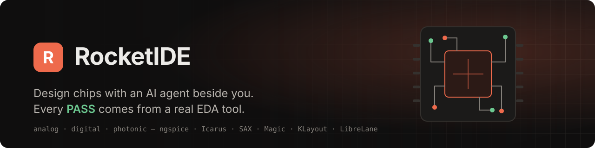
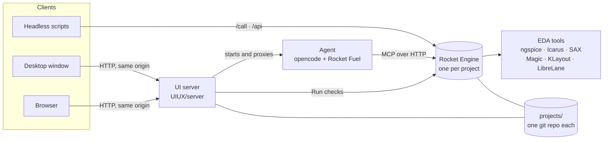

<p align="center">
  
</p>

<p align="center">
  
  
  
  
  
</p>

<p align="center">
  <a href="#quick-start"><b>Quick start</b></a> ·
  <a href="#how-it-works"><b>How it works</b></a> ·
  <a href="#demo-projects"><b>Demos</b></a> ·
  <a href="#honest-by-design"><b>Honest by design</b></a> ·
  <a href="#headless-api"><b>Headless API</b></a>
</p>

<br>

RocketIDE is a chip-design workbench where you and an AI agent work on the same project at the same time. You describe
what you want; the agent edits the design, runs real EDA tools and explains the result. You see every change, approve
what matters, and can do all of it by hand. Whether a check passes is decided by the engine's measurements, never by
what the agent says.

<p align="center">
  
</p>

## Why RocketIDE

<table>
  <tr>
    <td width="33%" valign="top">
      <h3>One engine, two operators</h3>
      The person in the IDE and the agent drive the same Rocket Engine. A run started by either one shows up for
      both: same evidence, same plots, same verdict.
    </td>
    <td width="33%" valign="top">
      <h3>Verdicts from real tools</h3>
      ngspice, Icarus Verilog, SAX, Magic, KLayout and LibreLane do the measuring. Targets come from
      <code>constraints.yaml</code>; the agent can't set or grade its own.
    </td>
    <td width="33%" valign="top">
      <h3>Guardrails built in</h3>
      Protected folders, a repair limit, an allowlist of engine tools and approvals for risky changes, enforced
      by the harness rather than by the prompt.
    </td>
  </tr>
</table>

## A look inside

<table>
  <tr>
    <td width="50%"></td>
    <td width="50%"></td>
  </tr>
  <tr>
    <td valign="top"><b>Plots.</b> Bode plots straight from the engine's own sweep, with the targets from <code>constraints.yaml</code> drawn in.</td>
    <td valign="top"><b>Layout.</b> The project's GDS, read and drawn in the browser: layers, cells, pan and zoom.</td>
  </tr>
  <tr>
    <td width="50%"></td>
    <td width="50%"></td>
  </tr>
  <tr>
    <td valign="top"><b>Verification.</b> Every check with its target, measured value, margin, source revision and the run that produced it.</td>
    <td valign="top"><b>Schematic.</b> Drawn from the netlists at this revision, with hierarchy, symbols and nets.</td>
  </tr>
</table>

## Demo projects

Three real designs ship with RocketIDE. Each opens as its own project, with its checks wired to the engine.

| Project | Domain | What it shows | Run checks |
|---|---|---|---|
| **8-bit waveform generator**<br>`Demos/waveform-generator` | Mixed-signal, sky130A | Phase accumulator, R-2R DAC and RC filter | ngspice AC sweep: passband and corner frequency |
| **MobileLLM-125M decoder chip**<br>`Demos/albert-chip-demo` | Digital, sky130A | A transformer decoder in RTL, with a first block placed and routed | Icarus `mac_unit` self-checking testbench |
| **Photonic matrix multiplier**<br>`Demos/photonic_matmul` | Photonic, CORNERSTONE Si340 | A 4×4 Reck mesh of tunable MZIs | SAX optical response |

You can also start a new project from the op-amp template, a two-stage amplifier on generic models that needs no
foundry PDK.

## Quick start

**You need** `git`, Node 20.12 or newer, [`uv`](https://docs.astral.sh/uv/), and a PDK for the engine to register:
sky130A at `~/.local/share/pdk/sky130A`, or point `PDK_SOURCE` at one. The engine's provisioner installs the EDA tools.

```sh
git clone --recurse-submodules https://github.com/Team-RocketEDA/RocketIDE.git
cd RocketIDE
./install.sh            # add --photonic for optical runs, --no-desktop to skip Electron
./run.sh                # http://localhost:5173
./run.sh desktop        # the same, plus the desktop window
```

<details>
<summary><b>Run it in Docker</b></summary>

<br>

The image is set up the way the engine's own image is: its locked environment, its pinned toolchain, and the PDK on
a volume that is registered when the container starts.

```sh
git submodule update --init --recursive
docker build -t rocketide .
docker run --rm -p 127.0.0.1:5173:5173 \
  -v /path/to/sky130A:/pdk:ro \
  -v rocketide-store:/stores/rocketeda \
  -v rocketide-projects:/opt/rocketide/projects \
  rocketide
```

Then open http://localhost:5173.
</details>

<details>
<summary><b>Choose the model</b></summary>

<br>

`install.sh` writes `.env`. The default is a free model that needs no key and shares one quota per machine. For Muse
Spark, set `ROCKET_MODEL=meta/muse-spark-1.3` and `MODEL_API_KEY`. Other providers read their usual variable, such as
`OPENROUTER_API_KEY` or `ANTHROPIC_API_KEY`.
</details>

## How it works



Setup follows the engine team's own flow, with the engine unchanged:

1. **Provision.** `install.sh` runs `rocket-engine/scripts/install.sh --install`. That sets up the engine's Python
   environment, registers the PDK, and installs its pinned toolchain through `provision_toolchain.sh --install`.
2. **Point at the tools.** `run.sh` puts the provisioned tools on `PATH` with `provision_toolchain.sh --print-path`.
3. **Launch the engine.** `run.sh` starts one engine, `scripts/engine-host.py`, on `127.0.0.1:8765`.
4. **Connect every client.** The web app, the desktop window and the agent all use that engine.

The engine host serves the engine's own MCP handlers, so argument checks, targets from `constraints.yaml`, source
confinement and evidence files are exactly what the engine itself does. Calls into one project take turns.

| Part | Repo | Role |
|---|---|---|
| **Rocket IDE** | [`UIUX/`](https://github.com/Team-RocketEDA/UIUX) | The workbench: projects, editor, assistant, schematic, layout, plots, verification |
| **Rocket Engine** | [`rocket-engine/`](https://github.com/Team-RocketEDA/rocket-engine) | Project management, tool dispatch, verdicts and evidence, for people and agents alike |
| **Rocket Fuel** | [`rocket_fuel/`](https://github.com/Team-RocketEDA/rocket_fuel) | The agent harness: prompts, protected paths, repair limit, tool allowlist, audit log |

## Honest by design

RocketIDE is built so that a green check means something.

- **The engine owns every verdict.** Statuses are `PASS`, `FAIL`, `NOT_RUN` or `UNSUPPORTED`, and only the engine sets
  them, from the tool's measurements. A process exiting cleanly is never a pass.
- **The agent can't grade its own work.** Targets and measurement formulas come from `constraints.yaml`. If the agent
  sends its own limits, the engine refuses them.
- **Missing tools are reported, not hidden.** A check whose tool or PDK isn't installed reports `NOT_RUN` with the
  reason. It never counts as a pass.
- **Old results are marked stale.** A result from an older commit, or from uncommitted design changes, is shown as
  stale until it's rerun.
- **The harness enforces the rules.** `results/`, `.git/` and the IP manifest are off-limits to the agent's edit tools,
  even through symlinks. Each executed run counts against the repair limit, and edits and runs stop when it's reached.
  Engine tools are an allowlist, so a tool the engine adds later stays hidden until someone reviews it.
- **Keys stay on the server.** The browser never talks to the engine or the agent directly, so passwords and model
  keys never reach browser code. The engine and the agent listen on loopback only, the web app binds `127.0.0.1` by
  default, and all of them refuse requests from other sites.

## Headless API

The engine that serves the IDE is also available to scripts on the same machine or container.

```sh
# Through the same handlers the IDE uses: run, fetch if deferred, record the evidence
curl -s localhost:8765/projects/waveform-generator/call \
  -H 'Content-Type: application/json' \
  -d '{"operation": "get_check_results", "arguments": {}}'

# The engine's own HTTP API, on the same engine
curl -s localhost:8765/projects/waveform-generator/api/ \
  -H 'Content-Type: application/json' \
  -d '{"project_id": "waveform-generator", "operation": "list_job_kinds", "arguments": {}}'
```

Any MCP client can attach at `http://127.0.0.1:8765/projects/<name>/mcp`. There is no authentication, so keep it on
loopback.

## Configuration

Set these in `.env`; anything already exported wins.

| Variable | Default | What it does |
|---|---|---|
| `ROCKET_MODEL` | `opencode/beam-free` | The agent's model |
| `MODEL_API_KEY` | empty | The key for a model that needs one |
| `PDK_SOURCE` | `~/.local/share/pdk/sky130A` | The PDK the engine registers at install |
| `PDK_ID`, `PDK_REVISION` | `sky130A`, the engine's pin | Which PDK that is |
| `ROCKET_PDK_ROOTS` | empty | PDK folders the agent may read but never edit, separated by `:` |
| `ROCKET_PROJECTS_DIR` | `./projects` | Where projects live |
| `ROCKET_UI_HOST`, `ROCKET_UI_PORT` | `127.0.0.1`, `5173` | The web app's address |
| `ROCKET_ENGINE_PORT` | `8765` | The shared engine, loopback only |

## What runs where

| Check | Needs |
|---|---|
| Op-amp template, waveform RC filter | `ngspice` |
| MobileLLM `mac_unit` testbench | `iverilog` |
| Photonic mesh | `./install.sh --photonic` (SAX and GDSFactory) |
| sky130A DRC, LVS and PDK simulation | The PDK registered at install (`/pdk` in Docker) |

The engine's provisioner installs the tools. Each demo's own README has its results, how to reproduce them, and any
flows that need more.

## Repository layout

```text
RocketIDE/
├── install.sh                 builds everything: engine, toolchain, agent, UI, demo projects
├── run.sh                     tool paths, then one engine, then the web app, desktop window and agent
├── Dockerfile                 the whole IDE in one Ubuntu 24.04 container
├── scripts/
│   ├── engine-host.py         the shared engine: IDE, agent (MCP) and headless clients
│   ├── seed-projects.sh       copies each demo into projects/ as its own git repo
│   └── smoke.py               end-to-end test of the assembled IDE
├── integration/overlays/      what each demo needs to open in the IDE (its constraints.yaml)
├── rocket-engine/  rocket_fuel/  UIUX/      the three parts, as submodules
└── Demos/                     the three demo projects, as submodules
```

The parts and demos are git submodules, each pinned to a tested commit, and the IDE never edits them. `install.sh`
copies each demo to `projects/`, where the IDE and the agent work on it. `scripts/seed-projects.sh --reset` restores
them from `Demos/`, and discards any work in those copies.

To move a part to the latest commit of its branch:

```sh
git submodule update --remote rocket-engine && git add rocket-engine && scripts/smoke.py
```

## Testing and releases

`scripts/smoke.py` starts the assembled IDE and drives it the way a person would: it opens each demo, runs its checks,
reads the plot data, and confirms the engine's APIs and the shared engine. `--agent` also sends a prompt to the model
and confirms it reached the engine. A check whose tool isn't installed reports SKIP, never a pass.

`.github/workflows/build.yml` builds the Docker image and the desktop app on a clean machine, and runs the photonic and
demo checks. It needs a `SUBMODULES_TOKEN` secret with read access to the submodule repos. Pushing a `v*` tag publishes
a release with the archive from `./install.sh --package`, once those jobs pass.

<br>

<p align="center">
  <sub>Built by <a href="https://github.com/Team-RocketEDA">Team RocketEDA</a>.</sub>
</p>
