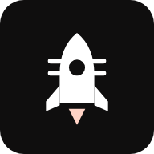
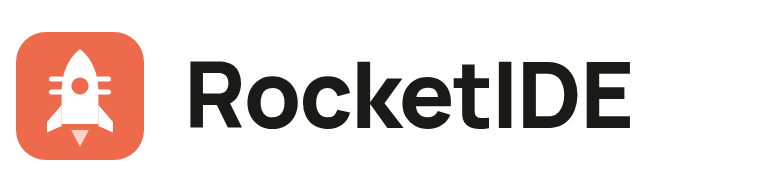

  

<h1 align="center">RocketIDE brand</h1>

The mark, its files, and how to use them.

## The mark: Launch Chip

A rocket whose body carries a chip's pins, on an orange tile. It says what RocketIDE does in one shape: chip design
that takes off. The window doubles as a via, and the four pins are the chip's I/O.

<table>
  <tr>
    <td align="center" width="25%"> <code>logo.svg</code> The default</td>
    <td align="center" width="25%"> <code>logo-glyph-orange.svg</code> On light, without the tile</td>
    <td align="center" width="25%"> <code>logo-glyph-white.svg</code> On dark or photos</td>
    <td align="center" width="25%"> <code>logo-glyph-black.svg</code> One-colour print</td>
  </tr>
</table>

### With the name

| On dark | On light |
|---|---|
|  |  |
| `lockup-on-dark.svg`, `png/lockup-on-dark.png` | `lockup-on-light.svg`, `png/lockup-on-light.png` |

The SVG lockups set the name in Manrope and fall back to the system font where Manrope isn't installed. Use the PNGs
where the exact letterforms matter, such as slides and posters.

## Files

| File | Use it for |
|---|---|
| `logo.svg` | Anywhere the logo appears: the app, docs, slides |
| `favicon.ico` | Browser tabs, with 16, 32 and 48 px inside |
| `png/logo-16.png` … `png/logo-1024.png` | App and OS icons: 16, 32, 48, 64, 128, 180 (Apple touch), 192, 256, 512, 1024 px |
| `png/logo-glyph-{orange,white,black}-512.png` | The rocket alone, when the tile doesn't fit the layout |
| `png/lockup-on-{dark,light}.png` | The mark with the name, 784 × 192 px |
| `png/social-preview.png` | GitHub's social preview (1280 × 640), in **Settings → General → Social preview** |
| `../images/banner.svg` | The README banner |

## Animations

| File | What it does | Use it for |
|---|---|---|
| `animations/logo-launch.svg` | The tile appears, the rocket rises and ignites, the window pops and the pins draw in. Then the flame idles. | Splash and welcome screens; the app's project picker plays it |
| `animations/logo-loop.svg` | The rocket floats with a flickering flame, forever | Loading and waiting states |
| `animations/banner-animated.svg` | The banner, with the logo launching and signals running along the die's traces | The top of the RocketIDE README |
| `animations/logo-launch.webm` | The launch, 2.5 s at 30 fps, 512 px, on the app's dark background | Slides and videos |
| `animations/banner-animated.webm` | The banner animation, 4 s, 1280 × 320 | Slides and videos |
| `animations/logo-launch.png` | The launch as an animated PNG, 256 px, transparent, plays once | Chat apps and anywhere a GIF would go |

Every animation is still under the system's reduced-motion setting, and the SVG animations play in GitHub READMEs.

## Colour

| | Name | Hex | Where |
|---|---|---|---|
|  | Rocket orange | `#ee6a4c` | The tile, the accent in the app |
|  | Flame | `#ffd3c6` | The flame on the tile |
|  | Ink | `#0f0e0e` | Backgrounds |
|  | Panel | `#1b1a19` | Cards and panels |
|  | Text | `#ecebe8` | Text on dark |
|  | Pass | `#6cc890` | Passing checks only, never decoration |

## Type

- **Wordmark:** Manrope ExtraBold (800), tracking −2 %.
- **Interface:** Inter, as in the app.
- **Data and code:** JetBrains Mono.

## Using the mark

- **Size:** at least 16 px on screen. Below 24 px the pins merge, which is expected.
- **Clear space:** keep a margin of at least a quarter of the tile's width around it.
- **Corners:** the tile's corner radius is 15 ⁄ 64 of its width. Keep it when resizing.
- **Don't** recolour the tile, rotate or stretch the rocket, add shadows or outlines, or put the orange tile on an
  orange background. Use the white glyph on busy backgrounds instead.
